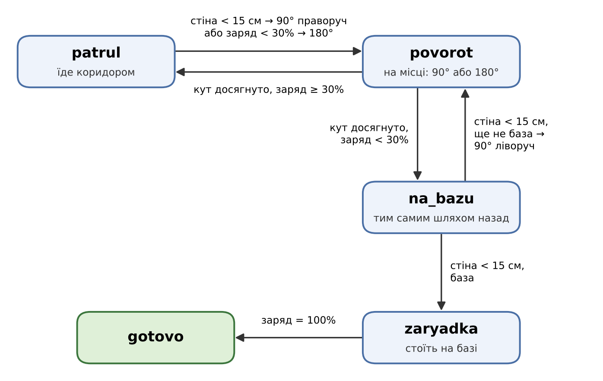

# Робота 6. Поведінка як автомат станів

Місія 4·1·2 — патрулювання периметра з поверненням на базу для заряджання; приміщення з прямими коридорами; обмежений заряд.

## Що робот має вміти

1. **Їхати коридором** ← сьогодні
2. **Повертати біля стіни й розвертатися** ← сьогодні
3. **Стежити за зарядом** (заряд падає під час руху) ← сьогодні
4. **Повертатися на базу, коли заряд низький** ← сьогодні
5. **Заряджатися на базі** ← сьогодні
6. Продовжувати патруль після заряджання
7. Об'їжджати перешкоду в коридорі
8. Виходити зі стану «застряг» (від'їхати, повернути, спробувати ще раз)

Сьогодні — пункти 1–5 на сцені з тижня 4: робот виїжджає з бази (жовтий квадрат) лівим проходом угору, біля стіни повертає праворуч і патрулює середній коридор; коли заряд падає, розвертається й тим самим шляхом повертається на базу заряджатися.

## Діаграма станів

Стани: `patrul → povorot → patrul → povorot → na_bazu → povorot → na_bazu → zaryadka → gotovo`

## Чому переходи саме такі

- **patrul → povorot** двома шляхами: стіна попереду (< 15 см) — кінець коридору, повертаємо на 90° праворуч, як у прогоні лабіринтом на тижні 4; заряд < 30% — розворот на 180°, щоб їхати назад. Перевірка заряду стоїть першою, бо повернення на базу важливіше за патруль.
- **povorot → patrul / na_bazu** за гіроскопом: гіроскоп скидається при вході в поворот, тому кут рахується від нуля. Перед поворотом запам'ятовується, на скільки градусів, у який бік і в який стан потім — тому одного стану `povorot` вистачає і для 90°, і для 180°.
- **na_bazu → povorot**: назад робот їде тим самим шляхом, тож кожен поворот праворуч у патрулі на зворотному шляху стає поворотом ліворуч. Лічильник `pravykh` рахує, скільки їх лишилось.
- **na_bazu → zaryadka**: коли лічильник дорівнює нулю, наступна стіна — нижня стіна біля бази, робот зупиняється на жовтому квадраті.
- **zaryadka → gotovo** при 100%: у повній місії тут буде перехід назад у `patrul`, для відео фрагмент закінчується.
- **Таймаут** є в кожному стані окремо (`patrul` 25 с, `na_bazu` 25 с, `povorot` 6 с, `zaryadka` 10 с): якщо умова виходу не спрацювала, робот зупиняється й друкує, у якому стані застряг. Перевірила навмисно: замінила умову повороту на `abs(gyro.angle) >= kut_cil + 500` (недосяжний кут) — у консолі `patrul -> povorot`, потім через 6 с `таймаут у стані povorot`, робот зупинився. Після перевірки повернула умову `kut_cil - 3`.

Заряд у симуляторі віртуальний: змінна, що зменшується з часом руху (у режимі `na_bazu` повільніше — економний рух) і зростає на базі.

## Глухий кут автомата

Стан `povorot`: якщо робот зачепиться за стіну під час розвороту й не докрутить до потрібного кута, з нього немає виходу за умовою. Вихід — таймаут 6 с. Наступний крок — замість зупинки переходити в стан «застряг» (від'їхати назад і повторити розворот).

## Відео

Фрагмент: старт на базі → угору до стіни → поворот праворуч → патруль середнім коридором → заряд падає нижче 30% → розворот → назад коридором → поворот ліворуч → униз до бази → зупинка на жовтому квадраті й заряджання → gotovo.

Відео: [map.mp4](map.mp4)

## Розбір

1. **Який стан найчастіше застрягав і чому?**
`povorot`. Спочатку робот одразу на старті починав крутитися на місці: ультразвуковий датчик у перший момент давав 0, і `patrul` вирішував, що попереду стіна. Після повороту кут гіроскопа міг рахуватися з мінусом, тож умова `>= 180` не виконувалась, і робот крутився, поки не спрацьовував таймаут. Виправила: показ 0 ігнорується, а кут порівнюю за модулем.

2. **Навіщо друкувати переходи, якщо робот і так видно на екрані?**
На екрані видно, що робот робить, але не видно чому. Робот, що стоїть, може бути і в `zaryadka`, і в `povorot`, у якому він зачепився за стіну, — ззовні це однаково. Друк показує, в якому стані робот і з яким зарядом він туди перейшов, тому одразу видно, яка умова не спрацювала. Саме так я знайшла проблему зі стартом: у консолі перший рядок був `patrul -> povorot`, хоча стіна була далеко.

3. **Що буде з вашим автоматом, якщо додати ще два кроки місії?**
Наприклад, «продовжити патруль після заряджання» й «об'їхати перешкоду». Для першого достатньо замінити перехід `zaryadka -> gotovo` на `zaryadka -> patrul` — інші стани не змінюються. Для другого потрібен новий стан `obizd` із переходами з `patrul` і `na_bazu` (перешкода ближче, ніж має бути стіна) і назад. Оскільки стан змінюється тільки через `perekhid()`, а поворот — через `povernuty()`, нові стани додаються окремими гілками й не ламають старі переходи. Складніше буде лише з поверненням на базу: після об'їзду лічильник поворотів `pravykh` має лишитися правильним.
